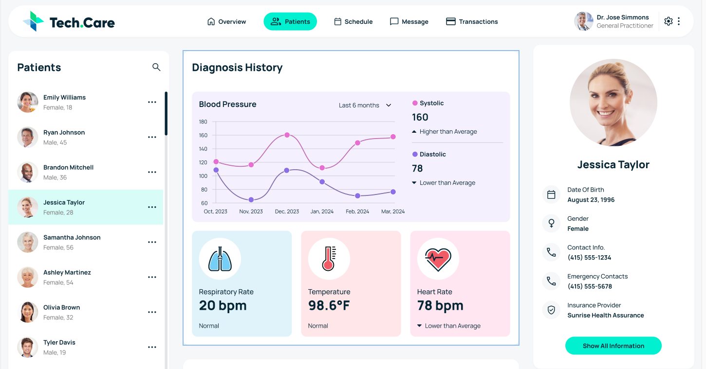

# Healthcare Dashboard – Tech.Care

A React dashboard for viewing patient information, diagnosis history, health metrics, diagnostic records, and lab results.



## Run locally

You’ll need [Node.js](https://nodejs.org/) and npm installed.

1. Clone the repository and enter the project folder:

   ```sh
   git clone https://github.com/Manoj5621/Healthcare.git
   cd Healthcare
   ```

2. Install dependencies:

   ```sh
   npm install
   ```

3. Create a `.env` file in the project root with the API settings:

   ```env
   VITE_API_URL=https://fedskillstest.coalitiontechnologies.workers.dev
   VITE_API_USERNAME=coalition
   VITE_API_PASSWORD=skills-test
   ```

4. Start the development server:

   ```sh
   npm run dev
   ```

   Open the local URL shown in the terminal.
